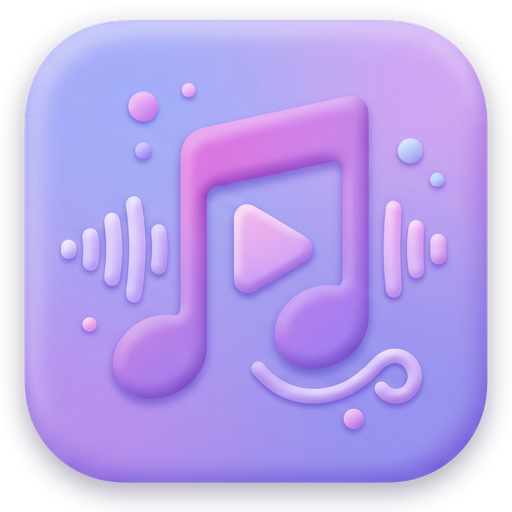

# Music Player

<p align="center">
  
</p>

<p align="center">
  <strong>A modern, lightweight, privacy-focused offline Android music player organized by folder structure.</strong>
</p>

<p align="center">
  
  
  
  
  
</p>

---

## 📖 Overview

**Music Player** is designed specifically for people who organize their music locally into folders. Unlike traditional players that force metadata-heavy library tags onto messy audio collections, Music Player treats your filesystem folders as first-class citizens while still providing a sleek, modern playback interface powered by Jetpack Compose and Material Design 3.

It is 100% offline, privacy-first, and contains zero network dependencies or analytics tracking.

---

## ✨ Features

- 📂 **Folder-Centric Organization**:
  - Automatically groups audio tracks based on their directory layout.
  - Dedicated "No Folder" grouping for standalone audio files placed at root storage locations.
  - Folder track counts, total folder durations, and individual file size indicators.

- 🔍 **Dual-Mode Storage Scanning**:
  - **MediaStore Scanner**: Fast indexing of local audio files with scoped storage compliance (Android 10+ / API 29+).
  - **Storage Access Framework (SAF)**: Manual folder (`OpenDocumentTree`) and file picker (`OpenMultipleDocuments`) support for directories not indexed by MediaStore (e.g. custom directories, SD cards).

- 🎵 **Comprehensive Playback Controls**:
  - **Persistent Mini-Player**: Bottom bar with one-tap play/pause, next track, and real-time progress indicator.
  - **Full-Screen Player Sheet**: Expanding bottom sheet with interactive seekbar, timestamp indicators, shuffle mode, and cyclical repeat modes (Off ➔ Repeat All ➔ Repeat One).

- 🎛️ **Background Playback & Lock Screen Integration**:
  - Background playback powered by Android `ForegroundService`.
  - Android `MediaStyle` notification with interactive playback actions (Play, Pause, Previous, Next).
  - Headphone disconnection detection (`ACTION_AUDIO_BECOMING_NOISY`) automatically pauses playback.
  - `PARTIAL_WAKE_LOCK` management ensures uninterrupted playback while the screen is off.

- 🎨 **Modern Design & Edge-to-Edge**:
  - Built entirely with **Jetpack Compose** and **Material Design 3**.
  - Dynamic edge-to-edge support with proper system bar padding.
  - Smooth fluid animations and responsive layout.

- 🔒 **Privacy-First & Lightweight**:
  - Fully offline operation. No network permissions requested in `AndroidManifest.xml`.
  - Zero third-party trackers or telemetry.

---

## 🏗️ Architecture & Tech Stack

The app follows the recommended Android Architecture guidelines using **MVVM** and **Unidirectional Data Flow (UDF)**:

```
app.kiddos.musicplayer
├── model/                 # Domain entities (AudioFile, MusicFolder, RepeatMode)
├── data/                  # MediaStore & SAF audio scanning (MusicScanner)
├── playback/              # MediaPlayer singleton controller (MusicPlayerManager)
├── service/               # Background playback & notifications (MusicService)
├── ui/                    # Jetpack Compose UI
│   ├── components/        # MiniPlayer, FullPlayerSheet
│   ├── screens/           # FolderListScreen, SongListScreen
│   ├── theme/             # Material 3 Color schemes, Type, Theme
│   ├── MusicApp.kt        # Root scaffold & permission flows
│   └── MusicViewModel.kt  # ViewModel coordinating playback & UI state
└── MainActivity.kt        # Single activity host with edge-to-edge enabled
```

### Technical Specifications
- **Language**: Kotlin 2.2.10
- **UI Framework**: Jetpack Compose (using Compose Compiler plugin & BOM)
- **Design System**: Material Design 3 (`androidx.compose.material3`)
- **State Management**: Kotlin Coroutines & `StateFlow`
- **Audio Engine**: Android `MediaPlayer` encapsulated in `MusicPlayerManager`
- **Minimum SDK**: Android 9.0 (API Level 28)
- **Target / Compile SDK**: Android 15 (API Level 36)

---

## 🚀 Getting Started

### Prerequisites
- **Android Studio**: Ladybug (2024.2.1) or newer
- **JDK**: Java 21 recommended (minimum Java 17)
- **Android SDK**: API Level 36
- **Test Device/Emulator**: Android 9.0 (API 28) or higher

### Build & Run Commands

You can build and test the project using the included Gradle wrapper (`./gradlew`):

```bash
# Clone the repository
git clone https://github.com/kiddos/MusicPlayer.git
cd MusicPlayer

# Assemble debug APK
./gradlew assembleDebug

# Output APK location:
# app/build/outputs/apk/debug/app-debug.apk

# Assemble release APK
./gradlew assembleRelease

# Run unit tests
./gradlew testDebugUnitTest

# Run instrumented tests on an attached device/emulator
./gradlew connectedDebugAndroidTest

# Run Android Lint analysis
./gradlew lintDebug
```

---

## 🛡️ Android Permissions

The application requests the following permissions strictly for local audio playback and system integration:

| Permission | Purpose | API Level |
|---|---|---|
| `READ_MEDIA_AUDIO` | Read audio files on device storage | Android 13+ (API 33+) |
| `READ_EXTERNAL_STORAGE` | Read audio files on device storage | Android 9 to 12 (API <= 32) |
| `FOREGROUND_SERVICE` | Keep music playing while the app is in the background | All |
| `FOREGROUND_SERVICE_MEDIA_PLAYBACK` | Foreground service specialization for media playback | Android 14+ (API 34+) |
| `POST_NOTIFICATIONS` | Display playback controls in the notification drawer | Android 13+ (API 33+) |
| `WAKE_LOCK` | Prevent CPU sleep during active audio playback | All |

---

## 🧪 Testing

Unit tests cover pure business logic, folder grouping, path resolution, and playback modes:

- `MusicPlayerModelTest.kt`: Validates `RepeatMode` cycling, `AudioFile` formatting, `MusicScanner.resolveFolderInfo`, and folder grouping / root storage ("No Folder") handling.

Run tests via:
```bash
./gradlew testDebugUnitTest
```

---

## 🤝 Contributing & Conventions

Contributions are welcome! Please check [AGENTS.md](AGENTS.md) for coding standards, architectural details, and guidelines:
- Adhere to `kotlin.code.style=official`.
- Maintain Unidirectional Data Flow in Compose components.
- Keep dependencies centralized in `gradle/libs.versions.toml`.
- Run unit tests before submitting changes.

---

## 📄 License

This project is licensed under the Apache License 2.0 - see the LICENSE file or repository details for more information.
